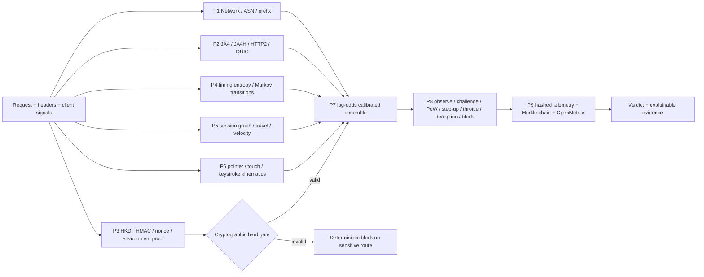
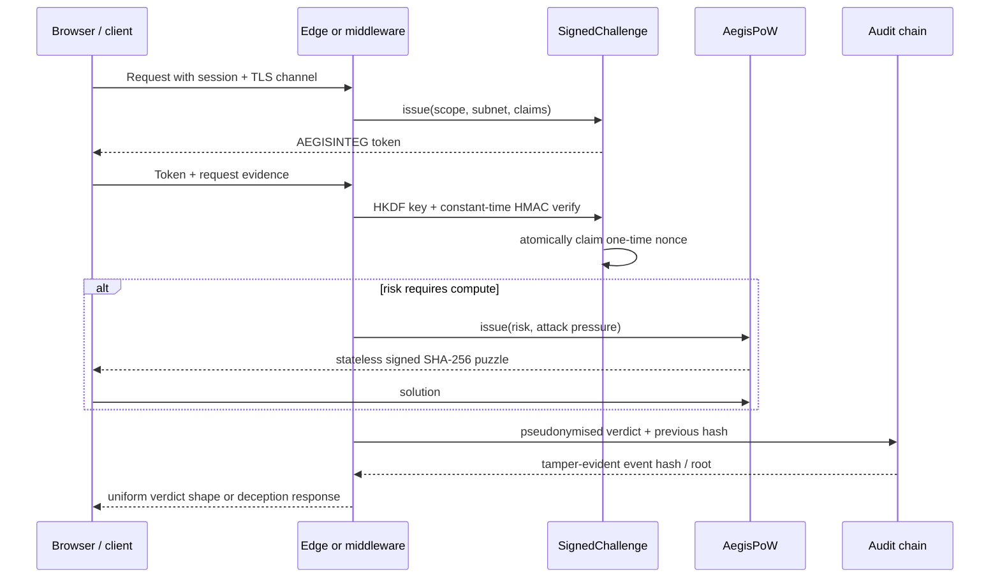
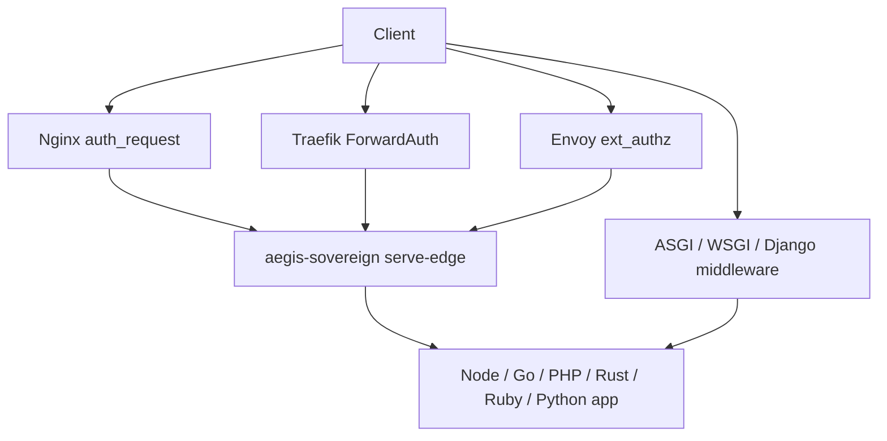

# AegisSovereign Architecture

**Cristi Labs** ([cristilabs.net](https://cristilabs.net)) maintains
AegisSovereign under the direction of **Marouan Rabai**
([marwenrabai.com](https://marwenrabai.com)). This document describes the
standard-library implementation shipped in `aegis_sovereign/`.

## Dataflow and fault domains



Every plane has an independent `CircuitBreaker`. A malformed request or plane
exception is converted into an observable fallback: `FAIL_CLOSED` for
`payout`, `withdrawal`, `auth.login`, `signin`, `recovery`, and `admin.*`;
`FAIL_OPEN_OBSERVE` for public reads. The worker remains available and P9
still receives the failure record.

## Plane contracts and latency budgets

| Plane | Inputs | Output | Default budget |
|---|---|---|---:|
| P1 | IP, CIDR, ASN, country, timezone, RTT | network risk and prefix rotation | 0.15 ms |
| P2 | TLS/JA4, JA4H, HTTP/2, QUIC, client hints | transport contradiction score | 0.12 ms |
| P3 | session, TLS channel, subnet, scope, nonce, claims | HMAC integrity gate | 0.10 ms |
| P4 | inter-arrivals and surface history | entropy/dispersion/Markov score | 0.08 ms |
| P5 | identity, session, channel, locations | split/mule/travel score | 0.08 ms |
| P6 | pointer, touch, keyboard events | kinematics score | 0.08 ms |
| P7 | P1-P6 evidence | calibrated `[0,1]` probability | 0.10 ms |
| P8 | probability, route, attack pressure | graduated response plan | 0.05 ms |
| P9 | verdict and evidence | privacy telemetry and audit link | 0.08 ms |

Budgets are design targets; measure the deployed machine with
`aegis-sovereign benchmark`. `SecurityConfig.plane_timeout_ms` and circuit
state provide bounded failure behavior even when an optional adapter is slow.

## Cryptographic lifecycle



`SignedChallenge` derives a per-scope key using HKDF-SHA256 and binds
`session_id`, `tls_channel_id`, client subnet, surface scope, timestamps,
nonce, difficulty, and canonical claims. `hmac.compare_digest` is used for
verification. The legacy seven-field token remains accepted for compatibility;
when a non-zero difficulty is used the extended wire form is:

```text
AEGISINTEG.<session>.<iat>.<exp>.<difficulty>.<nonce>.<claims_hash>.<hmac_sig>
```

`AegisPoW` signs its challenge metadata with HMAC-SHA256 and checks leading
zero bits in a SHA-256 digest. Difficulty scales from 14 to 28 bits by risk
and attack pressure.

## Runtime and bounded state

`UnifiedRunner.assess_request` is synchronous and optimized for gateway hot
paths. `assess_request_async` uses a bounded executor, while
`assess_batch_async` uses an asyncio semaphore to preserve back-pressure.
`ShardedTTLCache`, `SlidingWindow`, and `ReplayNonceCache` cap entries and
evict expired/LRU state. `MaintenanceManager` rotates telemetry epochs,
prunes state, rotates challenge epochs, and isolates callback failures.

## Universal deployment



The sidecar exposes `/decide` and JSON-RPC `/rpc`, `/healthz`, and
`/metrics`. Decision headers are `X-Aegis-Verdict`, `X-Aegis-Risk`, and
`X-Aegis-Challenge`. Native integrations lazy-import framework types only
when a Django response or framework application invokes them.

## Extension boundaries

Geo/ASN reputation is injected through `GeoIP` backends; application-specific
identity or WebAuthn assertions can be passed as claims/evidence. The core
does not fetch threat feeds, persist raw PII, or require a database. This
keeps the decision engine deterministic, portable, and auditable.
