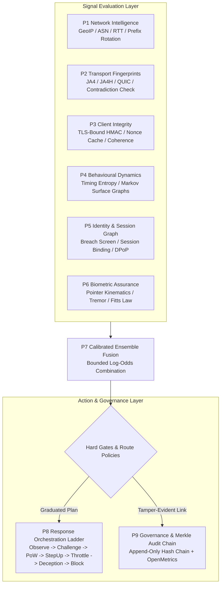

# AegisSovereign

[](https://github.com/Marwenrb/AegisSovereign/actions)


**Next-Gen 9-Plane Sovereign Anti-Automation, Bot Mitigation & Fraud Defense Engine.**

Developed by **[Cristi Labs](https://cristilabs.net)** &bull; Lead Architect & System Developer: **[Marouan Rabai](https://marwenrabai.com)**  
**Normative Reference:** `AEGIS-SOVEREIGN-2026`

---

## Executive Summary

AegisSovereign is a sovereign-grade defense engine engineered to mitigate automated abuse, credential stuffing, scraping, and account takeover. Operating with **zero external runtime dependencies** (pure standard-library Python), it delivers sub-millisecond assessment latency while providing mathematical, server-verifiable cryptographic guarantees.

Modern bot networks easily spoof User-Agents, simulate human cursor movements, and route traffic through residential proxy networks. AegisSovereign rejects probabilistic guesswork in favor of the core doctrine: **Cryptography over Inference. Cheap for legitimate humans, ruinously expensive for bot farms.**

---

## The 7 Core Design Principles

1. **Cryptography over Inference:** Server-verifiable HMAC proofs gate sensitive actions; probabilistic inference never overrides a failed proof.
2. **Cost Asymmetry:** Adaptive Proof-of-Work (PoW) and cryptographic puzzles scale attacker compute exponentially while human P99 latency stays under half a millisecond.
3. **No Attacker Oracle:** Uniform response payload shapes, withheld internal reason codes, and randomized timing jitter deny adversaries tuning feedback.
4. **Risk-Proportionate Friction:** Friction scales dynamically with expected business loss (`P(abuse) x Loss > Friction`), avoiding blanket blocks that hurt legitimate users.
5. **Layered Independence:** Nine planes operate behind isolated circuit breakers; spoofing any single layer cannot flip the aggregate verdict.
6. **Deliberate Failure Policies:** Explicit per-route `FAIL_CLOSED` (sensitive financial routes) or `FAIL_OPEN_OBSERVE` (public content) declarations prevent cascading outages.
7. **Privacy & Accessibility by Design:** Automated data minimization, one-way hashed audit trails, retention limits, and zero discrimination against assistive technologies.

---

## Visual Architecture: The 9-Plane Pipeline



---

## Complete Documentation Suite

Detailed, step-by-step guides are available in the [`docs/`](docs/) directory:

| Document | Purpose & Key Topics |
| :--- | :--- |
| **[01. Getting Started](docs/01-GETTING-STARTED.md)** | Prerequisites, installation, running `doctor`, first assessment script, verdict breakdown. |
| **[02. Architecture of the 9 Planes](docs/02-ARCHITECTURE-9-PLANES.md)** | Deep dive into P1–P9, 7 design principles, circuit breakers, and fail-open/closed policies. |
| **[03. Cryptographic Challenges](docs/03-CRYPTOGRAPHIC-CHALLENGES.md)** | `AEGISINTEG` token anatomy, lifecycle sequence, `AegisPoW` puzzle solver, browser client SDK. |
| **[04. Middleware Integration](docs/04-MIDDLEWARE-INTEGRATION.md)** | FastAPI, Starlette, Flask, reverse proxy header forwarding (Nginx), and edge sidecar server. |
| **[05. CLI & Operations](docs/05-CLI-AND-OPERATIONS.md)** | `doctor`, `benchmark`, `inspect-config`, `serve-edge`, production tuning, and troubleshooting. |
| **[06. Testing & Verification](docs/06-TESTING-AND-VERIFICATION.md)** | Running `verify_*.py`, test suite execution, writing custom residential/datacenter fixtures. |

---

## 5-Minute Quickstart

### 1. Installation

AegisSovereign has zero mandatory runtime dependencies.

```bash
git clone https://github.com/Marwenrb/AegisSovereign.git
cd AegisSovereign
pip install -e .
```

### 2. Multi-Plane Traffic Assessment

```python
from aegis_sovereign import UnifiedRunner
from aegis_sovereign.network_fixtures import ResidentialGeoBackend, DatacenterGeoBackend

# Initialize runner
runner = UnifiedRunner(geo_backend=ResidentialGeoBackend())

# Evaluate traffic
verdict = runner.assess_request(
    remote_ip="203.0.113.9",
    claimed_os="Windows 11",
    claimed_country="FR",
    user_agent="Mozilla/5.0 (Windows NT 10.0; Win64; x64) Chrome/124.0.0.0",
    platform="windows",
    languages=["fr-FR", "en"],
    timezone="Europe/Paris",
    screen_geometry="1920x1080x24",
    surface="registration.create",
)

print(verdict.decision)    # 'allow'
print(verdict.risk_score)  # ~0.16
print(f"Latency: {verdict.audit_event.latency_ms:.3f} ms")
```

### 3. TLS-Bound Cryptographic Challenge

```python
from aegis_sovereign.client_challenge import SignedChallenge

svc = SignedChallenge(secret_key="production-secret", ttl_seconds=5, buffer_seconds=15)
token = svc.issue(session_id="user_123", tls_channel_id="tls_ch_456", claims={"scope": "payout"})

# Verify
valid, reason = SignedChallenge.verify(
    token.token,
    secret_key="production-secret",
    session_id="user_123",
    tls_channel_id="tls_ch_456",
    claims={"scope": "payout"},
)
assert valid is True
```

### 4. FastAPI Middleware

```python
from fastapi import FastAPI
from aegis_sovereign.middleware import StarletteAegisMiddleware
from aegis_sovereign import UnifiedRunner

app = FastAPI()
app.add_middleware(StarletteAegisMiddleware, runner=UnifiedRunner())

@app.post("/api/v1/auth/login")
async def login():
    return {"status": "authenticated"}
```

### 5. CLI Diagnostics & Benchmarking

```bash
# Validate system health
aegis-sovereign doctor

# Run latency benchmark across 8 worker threads
aegis-sovereign benchmark -n 1000 --concurrency 8

# Run edge decision server on port 8787
aegis-sovereign serve-edge --host 0.0.0.0 --port 8787
```

---

## Clean Linux Rebuild & Execution Guide

To reproduce and run this project from scratch on any clean Linux machine (Ubuntu, Debian, Fedora, Arch, Alpine):

```bash
# 1. Clone repository
git clone https://github.com/Marwenrb/AegisSovereign.git
cd AegisSovereign

# 2. Set up virtual environment
python3 -m venv .venv
source .venv/bin/activate

# 3. Install package
pip install -e .

# 4. Run automated tests (One command)
make test
# OR: python3 -m unittest discover tests -v

# 5. Run verification suite
make verify

# 6. Run doctor diagnostics
make doctor

# 7. Start live edge server
aegis-sovereign serve-edge --host 0.0.0.0 --port 8787
```

### Docker Execution

```bash
# Build production container
docker build -t aegis-sovereign .

# Run edge server container
docker run -p 8787:8787 aegis-sovereign
```

---

## Security Policy

Security reports are reviewed within 2 business days. Please report vulnerabilities to **security@cristilabs.net**. Read our full [SECURITY.md](SECURITY.md) for details.

---

## License

Licensed under the [Apache License, Version 2.0](LICENSE).

---

## Credits & Authorship

- **Lead Developer & System Architect:** **[Marouan Rabai](https://marwenrabai.com)**
- **Developed & Maintained By:** **[Cristi Labs](https://cristilabs.net)**
- **GitHub Repositories:**  
  - [https://github.com/Marwenrb/AegisSovereign](https://github.com/Marwenrb/AegisSovereign)  
  - [https://github.com/connectifyambassador-spec/AegisSovereign](https://github.com/connectifyambassador-spec/AegisSovereign)
