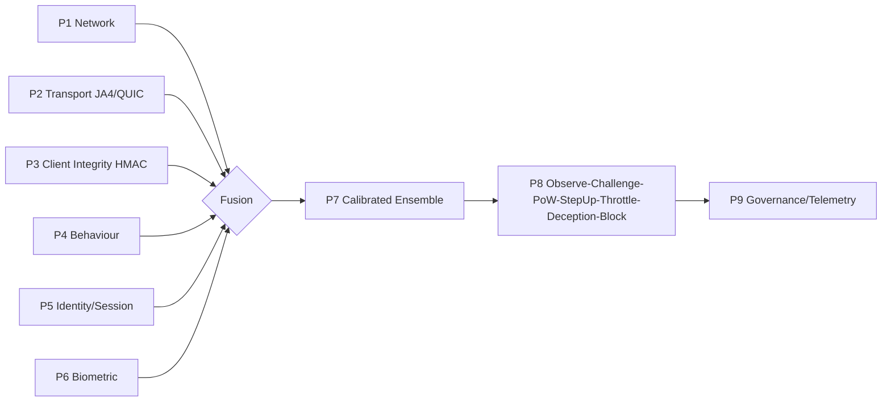

# AegisSovereign — Part 1


**Next-Gen 9-Plane Sovereign Anti-Automation, Bot Mitigation & Fraud Defense Engine.**

By **Cristi Labs (https://cristilabs.net)** — Lead Architect:
**Marouan Rabai (https://marwenrabai.com)**.

AegisSovereign fuses nine independent evidence planes into one calibrated,
auditable decision. Cryptography first, inference second. Cheap for humans,
ruinously expensive for bot farms.

## 7 Core Design Principles

1. **Cryptography over Inference** — server-verifiable HMAC proofs gate
   sensitive actions; ML-style signals never override a failed proof.
2. **Cost Asymmetry** — PoW, challenges, and tarpits scale attacker cost
   while legitimate P99 latency stays sub-millisecond.
3. **No Attacker Oracle** — uniform shapes, withheld reason codes, and
   randomized timing deny tuning feedback.
4. **Risk-Proportionate Friction** — friction follows expected loss
   (`P(abuse) x Loss > Friction`), never uniform punishment.
5. **Layered Independence** — nine planes fail independently; no single
   spoofed signal flips the verdict.
6. **Fail Deliberately** — every route declares fail-open/fail-closed.
7. **Privacy by Design** — minimization, hashed telemetry, retention limits.



## Quickstart — residential vs datacenter

```python
from aegis_sovereign import UnifiedRunner
from aegis_sovereign.network_fixtures import ResidentialGeoBackend, DatacenterGeoBackend

good = UnifiedRunner(geo_backend=ResidentialGeoBackend()).assess_request(
    remote_ip="203.0.113.9", claimed_os="Windows 11", claimed_country="BR",
    user_agent="Mozilla/5.0 (Windows NT 10.0; Win64; x64)", platform="windows",
    languages=["pt-BR"], timezone="America/Sao_Paulo",
    screen_geometry="1920x1080x24", fonts=["Arial"],
    gpu_renderers=["ANGLE (NVIDIA)"], codecs=["h264"],
    input_modality="mouse", session_id="sess_123", tls_channel_id="tls_456",
    surface="registration.create",
)
print(good.decision, round(good.risk_score, 4))  # allow ~0.05

bad = UnifiedRunner(geo_backend=DatacenterGeoBackend()).assess_request(
    remote_ip="198.51.100.23", claimed_os="Windows 11", claimed_country="US",
    user_agent="bot", session_id="sess_456", tls_channel_id="tls_789",
    surface="payout", webdriver=True,
)
print(bad.decision, round(bad.risk_score, 4))  # challenge ~0.55
```

## Cryptographic TLS-bound challenge

```python
from aegis_sovereign.client_challenge import SignedChallenge

svc = SignedChallenge(secret_key="prod-secret", ttl_seconds=5, buffer_seconds=15)
tok = svc.issue(session_id="s1", tls_channel_id="tls1", claims={"scope": "payout"})
print(tok.token)  # AEGISINTEG.s1.1712345678.1712345683.nonce.hash.sig

ok, reason = SignedChallenge.verify(
    tok.token, secret_key="prod-secret", session_id="s1",
    tls_channel_id="tls1", claims={"scope": "payout"},
)
assert ok, reason
```

## Middleware

```python
# FastAPI / Starlette
from aegis_sovereign.middleware import StarletteAegisMiddleware
app.add_middleware(StarletteAegisMiddleware)

# Flask
from aegis_sovereign.middleware import flask_guard
guard = flask_guard()

@app.before_request
def _aegis():
    verdict = guard(request)
    if verdict and verdict.decision == "block":
        return {"denied": True}, 403
```

## CLI + telemetry

```bash
pip install -e .
aegis-sovereign doctor
aegis-sovereign benchmark -n 500
aegis-sovereign inspect-config --json
python verify_imports.py && python verify_config.py && python verify_unified.py
python -m unittest tests.test_aegis_sovereign -v
```

## Credits

- **Lead Developer & System Architect:** **Marouan Rabai** —
  [https://marwenrabai.com](https://marwenrabai.com)
- **Developed & Maintained By:** **Cristi Labs** —
  [https://cristilabs.net](https://cristilabs.net)

