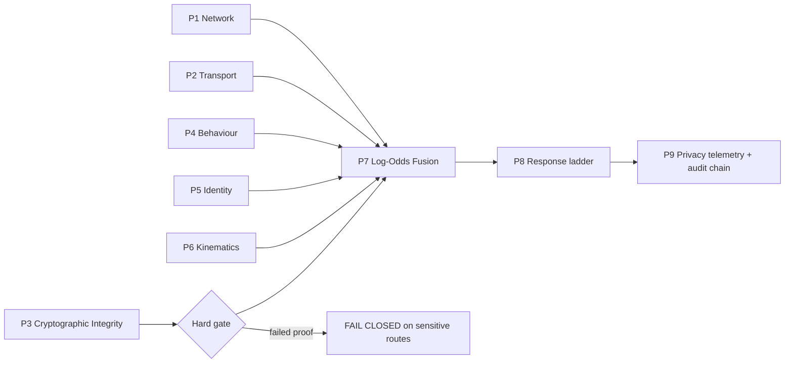

# AegisSovereign

[](https://www.python.org/)
[](requirements.lock)
[](ARCHITECTURE.md)
[](ARCHITECTURE.md)
[](SECURITY.md)
[](ARCHITECTURE.md)
[](LICENSE)

**Sovereign-grade 9-plane anti-automation, bot mitigation, and fraud defense
for web applications, APIs, microservices, and static/dynamic sites.**

Developed by **[Cristi Labs](https://cristilabs.net)** and architected by
**[Marouan Rabai](https://marwenrabai.com)**.

AegisSovereign has zero mandatory runtime dependencies: the core uses only the
Python 3.10–3.13 standard library. Optional ASGI, WSGI, Flask, and Django
adapters are lazy-imported.

## Architecture at a glance



| Plane | Focus | Representative failure signal |
|---|---|---|
| P1 | CIDR, ASN class, routing and rapid prefix rotation | cloud, Tor, proxy, geo mismatch |
| P2 | JA4/JA4H, HTTP/2, QUIC and client hints | Chrome claim vs library TLS |
| P3 | HKDF/HMAC, environment coherence, replay | wrong TLS channel or nonce replay |
| P4 | entropy, dispersion and Markov navigation | fixed intervals/direct sensitive jump |
| P5 | session/channel graph and travel velocity | session split or impossible travel |
| P6 | pointer, touch and keystroke dynamics | synthetic linear dispatch |
| P7 | calibrated log-odds and synergy matrix | cross-plane contradiction |
| P8 | observe, challenge, PoW, step-up, throttle, deception, block | risk-proportionate friction |
| P9 | hashed telemetry, Merkle chain, OpenMetrics | tamper evidence and metrics |

See [ARCHITECTURE.md](ARCHITECTURE.md) for full contracts, budgets, and
deployment topology. See [SECURITY.md](SECURITY.md) for threat model and
operational guidance.

## Install, run, test, deploy

```bash
git clone https://github.com/Marwenrb/AegisSovereign.git
cd AegisSovereign
python3.12 -m venv .venv
. .venv/bin/activate
python -m pip install -e .
make test
make verify
```

The pinned runtime is in `.python-version`; `requirements.lock` records the
zero-runtime-dependency contract. Run locally with:

```bash
aegis-sovereign doctor
aegis-sovereign serve-edge --host 127.0.0.1 --port 8787
```

Build and run the reproducible sidecar image:

```bash
docker run --rm -p 8787:8787 -e SECRET_KEY="replace-me" aegis-sovereign:local
```

## Quickstart: residential, datacenter, stealth headless

```python
from aegis_sovereign import UnifiedRunner
from aegis_sovereign.network_fixtures import ResidentialGeoBackend, DatacenterGeoBackend

human = UnifiedRunner(geo_backend=ResidentialGeoBackend()).assess_request(
    remote_ip="203.0.113.9", claimed_os="Windows 11", claimed_country="BR",
    user_agent="Mozilla/5.0 (Windows NT 10.0; Win64; x64)", platform="windows",
    languages=["pt-BR"], timezone="America/Sao_Paulo", screen_geometry="1920x1080x24",
    fonts=["Arial"], gpu_renderers=["ANGLE (NVIDIA)"], codecs=["h264"],
    input_modality="mouse", session_id="human-1", tls_channel_id="tls-1",
    surface="registration.create",
)

datacenter = UnifiedRunner(geo_backend=DatacenterGeoBackend()).assess_request(
    remote_ip="198.51.100.23", user_agent="curl/8.0", surface="auth.login",
    session_id="bot-1", tls_channel_id="tls-bot",
)

stealth = UnifiedRunner(geo_backend=DatacenterGeoBackend()).assess_request(
    remote_ip="198.51.100.24", user_agent="Mozilla/5.0 HeadlessChrome/120",
    screen_geometry="0x0", webdriver=True, surface="payout",
)
print(human.decision, datacenter.decision, stealth.decision)
```

`AssessmentResult` is an immutable, explainable verdict with a bounded
`risk_score` in `[0, 1]`, family scores, response plan, evidence, and plane
health state.

## Async multi-task batch evaluation

```python
import asyncio
from aegis_sovereign import AsyncUnifiedRunner

async def main() -> None:
    runner = AsyncUnifiedRunner()
    verdicts = await runner.assess_batch_async([
        {"remote_ip": "203.0.113.9", "surface": "public.read"},
        {"remote_ip": "198.51.100.9", "surface": "auth.login"},
    ], concurrency=16)
    print([v.decision for v in verdicts])

asyncio.run(main())
```

## TLS-bound challenge and dynamic PoW

```python
from aegis_sovereign.client_challenge import SignedChallenge
from aegis_sovereign.pow import AegisPoW

challenge_service = SignedChallenge("replace-with-secret", ttl_seconds=60)
token = challenge_service.issue(session_id="s1", tls_channel_id="tls1",
                                client_ip="203.0.113.9", surface_scope="payout",
                                claims={"scope": "payout"})
valid, reason = challenge_service.verify_token(
    token.token, session_id="s1", tls_channel_id="tls1",
    client_ip="203.0.113.9", surface_scope="payout", claims={"scope": "payout"})
assert valid, reason

pow_engine = AegisPoW("replace-with-secret")
puzzle = pow_engine.issue(risk_score=0.75, attack_pressure=0.5, subject="payout")
solution = AegisPoW.solve(puzzle)
assert pow_engine.verify(puzzle.token, solution, subject="payout")[0]
```

The compatibility token is `AEGISINTEG.<session>.<iat>.<exp>.<nonce>.<claims_hash>.<hmac_sig>`.
When difficulty is bound, the extended wire format is
`AEGISINTEG.<session>.<iat>.<exp>.<difficulty>.<nonce>.<claims_hash>.<hmac_sig>`.
The nonce is one-time and bounded by TTL.

## Framework and universal edge adapters

```python
# FastAPI / Starlette / Litestar / Quart
from aegis_sovereign.middleware import StarletteAegisMiddleware
app.add_middleware(StarletteAegisMiddleware)

# Flask
from aegis_sovereign.middleware import flask_guard
guard = flask_guard()
@app.before_request
def aegis_before_request():
    verdict = guard(request)
    if verdict.decision == "block":
        return {"denied": True}, 403

# WSGI / Gunicorn
from aegis_sovereign.middleware import WSGIAegisMiddleware
application = WSGIAegisMiddleware(application)

# Django settings.py
MIDDLEWARE = ["aegis_sovereign.middleware.DjangoAegisMiddleware", *MIDDLEWARE]
```

For any language, put the sidecar behind the gateway. Nginx example:

```nginx
location / {
    auth_request /_aegis;
    proxy_pass http://application;
}
location = /_aegis {
    internal;
    proxy_pass http://127.0.0.1:8787/decide;
    proxy_pass_request_body off;
    proxy_set_header Content-Length "";
    proxy_set_header X-Aegis-Surface $request_uri;
    proxy_set_header X-Session-Id $cookie_session;
}
```

Traefik ForwardAuth, Envoy `ext_authz`, Caddy, Node, Go, PHP, Rust, and Ruby
clients can use the same JSON endpoint and `X-Aegis-*` decision headers.
Generate the browser helper with:

```python
from aegis_sovereign.client_sdk import generate_client_sdk
script = generate_client_sdk(endpoint="/.well-known/aegis/challenge")
```

## CLI operations

```bash
aegis-sovereign doctor
aegis-sovereign doctor --json
aegis-sovereign benchmark -n 5000 --concurrency 16
aegis-sovereign simulate --scenario residential
aegis-sovereign simulate --scenario datacenter_bot
aegis-sovereign simulate --scenario stealth_headless
aegis-sovereign simulate --scenario credential_stuffing
aegis-sovereign simulate --scenario replay_attack
aegis-sovereign inspect-config --json
```

`doctor` checks HMAC, replay-safe challenge flow, PoW, config, plane health,
and latency. Benchmark output includes P50, P95, P99, P99.9, maximum latency,
and requests per second.

## Attribution and license

- **Lead Architect & Developer:** [Marouan Rabai](https://marwenrabai.com)
- **Engineering Lab and Maintainer:** [Cristi Labs](https://cristilabs.net)
- License: [Apache-2.0](LICENSE)
