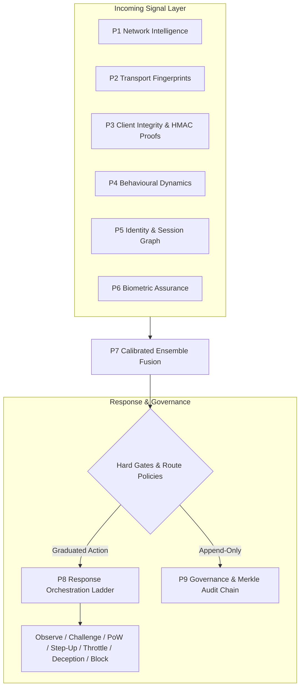

# 02 — Architecture of the 9-Plane Defense Engine

**Lead Architect & Developer:** [Marouan Rabai](https://marwenrabai.com)  
**Maintained by:** [Cristi Labs](https://cristilabs.net)  
**Normative Reference:** `AEGIS-SOVEREIGN-2026`

---

## Executive Architectural Summary

AegisSovereign rejects the traditional security paradigm of relying on probabilistic ML classifiers or single client-side fingerprinting scripts. Attackers easily replay fingerprints, spoof headers, and manipulate browser APIs using automated browser instances.

AegisSovereign enforces a multi-plane, defence-in-depth doctrine: **Layer independent physical, cryptographic, and kinematic signals; calibrate them in bounded log-odds space; and mandate cryptographic proofs on sensitive operations.**

---

## The 7 Core Design Principles

1. **Cryptography over Inference:** Server-verifiable HMAC proofs and challenge solutions gate high-value routes. Probabilistic behavioural signals never override a failed cryptographic proof.
2. **Cost Asymmetry:** Legitimate users execute standard HTTP calls in sub-millisecond time (`< 0.5 ms`). Attackers attempting large-scale brute force are hit with exponential compute costs via adaptive Proof-of-Work (`AegisPoW`) and dynamic tarpits.
3. **No Attacker Oracle:** Deny adversaries tuning feedback. Response payload shapes remain identical across verdict boundaries, reason codes are withheld from clients, and timing jitter is randomized.
4. **Risk-Proportionate Friction:** Friction scales monotonically with expected business loss (`P(abuse) x Value > Cost(friction)`). Sensitive endpoints (`payout`, `recovery`) demand strict proof; public landing pages remain frictionless.
5. **Layered Independence:** The 9 planes run behind circuit breakers with independent timeouts. An attacker spoofing an IP cannot bypass JA4 transport mismatches or client coherence checks.
6. **Deliberate Failure Policies:** Each route defines an explicit failure mode (`FAIL_CLOSED` on sensitive routes like `payout`, `FAIL_OPEN_OBSERVE` on public content), preventing denial-of-service from backend dependencies.
7. **Privacy & Accessibility by Design:** Client data is hashed before persistence using one-way cryptographic salts. Assistive technologies and screen readers are explicitly accommodated without penalty.

---

## Deep Dive into the 9 Defense Planes

### Plane 1: Network Intelligence (P1)
- **Module:** `aegis_sovereign.network_intel`
- **Capabilities:**
  - Autonomous System Number (ASN) classification: Residential, Datacenter, Commercial, VPN, Proxy, or Tor exit.
  - Round-Trip Time (RTT) consistency checking: Detects proxies claiming to reside in a country whose RTT violates physical speed-of-light limits.
  - Subnet prefix rotation tracking: Monitored via sharded TTL caches to detect coordinated bot subnet hopping.
  - Passive OS fingerprinting via TCP window size and TTL analysis.

### Plane 2: Transport Fingerprinting (P2)
- **Module:** `aegis_sovereign.transport`
- **Capabilities:**
  - JA4 TLS client fingerprint extraction (TLS version, cipher counts, extension hashes, ALPN values).
  - JA4H HTTP request header ordering and capitalization checks.
  - QUIC / HTTP/3 connection validation.
  - Transport-vs-User-Agent contradiction detection (e.g., claiming to be macOS Safari while presenting a Linux Chrome TLS cipher suite).

### Plane 3: Client Integrity & TLS-Bound HMAC Proofs (P3)
- **Module:** `aegis_sovereign.client_challenge` & `aegis_sovereign.client_signals`
- **Capabilities:**
  - Short-lived, server-verifiable HMAC tokens (`SignedChallenge`) cryptographically bound to session ID, TLS channel, and route scope.
  - Replay prevention using atomic `ReplayNonceCache` claims.
  - Multi-attribute client coherence analysis: Verifies that screen geometry, timezone, language, WebGL renderers, audio codecs, and platform declarations are mutually consistent.
  - Population rarity analysis (`PopulationRarity`) to detect rare or anomalous device configurations across fleets.

### Plane 4: Behavioural & Temporal Telemetry (P4)
- **Module:** `aegis_sovereign.behavior`
- **Capabilities:**
  - Inter-arrival request timing entropy: Differentiates Poisson-distributed human requests from constant-delay or uniform-jitter automated scripts.
  - First-order Markov surface transition graphs (`SurfaceTransitionGraph`): Measures whether request flow follows natural user journeys or directly hits high-value endpoints without browsing prerequisites.

### Plane 5: Identity & Session Graph (P5)
- **Module:** `aegis_sovereign.identity`
- **Capabilities:**
  - Pwned/breached credential screening via k-anonymity SHA-1 hash prefixes.
  - Session-to-device public key binding (`SessionBinder`) using DPoP and WebAuthn credentials to eliminate cookie-theft and token replay attacks.
  - Impossible travel and geographic velocity detection across sessions.

### Plane 6: Biometric & Human Kinematics (P6)
- **Module:** `aegis_sovereign.behavior`
- **Capabilities:**
  - Pointer kinematics analysis: Differentiates natural curved trajectories exhibiting micro-tremor from synthetic linear/Bézier simulated pointer events.
  - Fitts's law compliance modeling (`fitts_compliance`).
  - Mobile touch pressure/area distribution entropy and keystroke dwell/flight time validation.

### Plane 7: Calibrated Decision Engine (P7)
- **Module:** `aegis_sovereign.fusion` & `aegis_sovereign.risk_engine`
- **Capabilities:**
  - Log-odds evidence combination across signal families (`network`, `transport`, `client`, `identity`, `behaviour`, `graph`).
  - Hard gate filters: Invariant rules that trigger deterministic containment regardless of aggregate probability (e.g., confirmed datacenter IP hitting sensitive endpoints without an integrity token).
  - Route sensitivity weighting.

### Plane 8: Response Orchestration Ladder (P8)
- **Module:** `aegis_sovereign.response_ladder` & `aegis_sovereign.pow`
- **Graduated Actions:**
  1. **Observe (Rung 0):** Log telemetry; pass through transparently.
  2. **Invisible Challenge (Rung 1):** Issue cryptographic HMAC challenge.
  3. **Adaptive PoW (Rung 2):** Issue CPU puzzle (`AegisPoW`) scaled to threat score.
  4. **Step-Up Verification (Rung 3):** Demand passkey or human presence proof.
  5. **Tarpit Delay (Rung 4):** Asynchronously sleep 100ms–500ms to throttle scraper throughput.
  6. **Controlled Deception (Rung 5):** Return synthetic honey-tokens or poisoned data.
  7. **Hard Block (Rung 6):** Immediate termination with 403 Forbidden.

### Plane 9: Governance, Telemetry & Merkle Audit Chain (P9)
- **Module:** `aegis_sovereign.audit_chain` & `aegis_sovereign.audit_sink`
- **Capabilities:**
  - Append-only cryptographic hash chain (`MerkleAuditChain`): Every decision produces a `ChainLink` linking `previous_hash` and `event_hash` to guarantee tamper-evident auditability.
  - High-performance `InMemorySink` with O(1) sliding ring-buffers calculating real-time p50, p95, and p99 score and latency percentiles.
  - OpenMetrics telemetry export for Prometheus and Grafana dashboards.
  - Pseudonymized telemetry hashing for strict privacy regulations (GDPR/CCPA).

---

## Fault Domains & Resilience Architecture

Every plane evaluation in `UnifiedRunner` executes within an isolated `CircuitBreaker`. If a database lookup, IP feed, or external check raises an exception or times out:

1. The circuit breaker increments its failure counter.
2. If threshold (`circuit_failure_threshold = 3`) is reached, the breaker trips open for `circuit_reset_seconds = 5.0`.
3. The fallback policy evaluates the route:
   - Sensitive routes (`payout`, `recovery`, `signin`): **`FAIL_CLOSED`** &rarr; Request blocked or challenged.
   - Non-sensitive routes (`public.read`): **`FAIL_OPEN_OBSERVE`** &rarr; Request allowed with observation flag.
4. Total assessment latency remains bounded under `SecurityConfig.plane_timeout_ms` (default: 0.75 ms).
